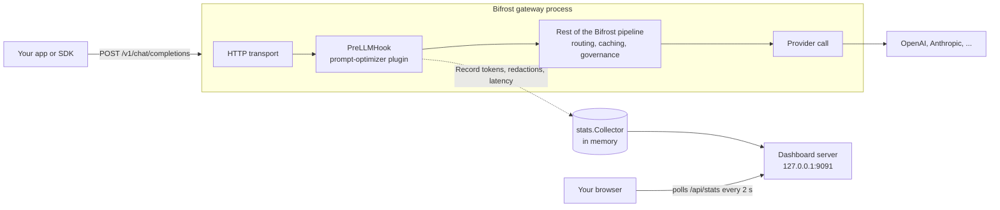
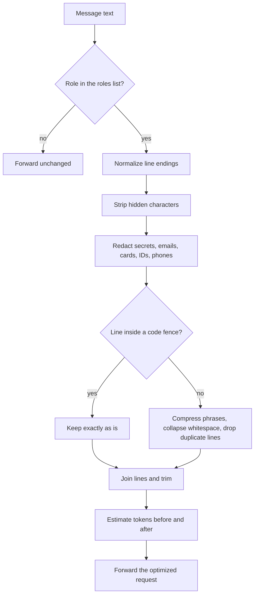

# Prompt Optimizer for Bifrost

A [Bifrost](https://github.com/maximhq/bifrost) gateway plugin that **shrinks, cleans and sanitizes prompts before they reach an LLM provider**, plus a live dashboard that shows how many tokens, how much money and how much latency it costs or saves.

Built for the Global AI Hackathon, Problem Statement 04 (Contributor Track): *build a feature the open-source gateway is missing*.

## The problem

Applications often send prompts that are much bigger than they need to be:

| Symptom | What it causes |
| --- | --- |
| Runs of spaces, tabs and blank lines, copy-pasted duplicate lines, wordy boilerplate | You pay for tokens that carry no meaning, and long prompts add latency |
| Emails, phone numbers, card numbers, API keys and tokens pasted into prompts | Sensitive text leaves your network and can end up in provider logs |
| Invisible characters (zero-width spaces, bidi overrides) | Hidden token cost and a known prompt-injection trick |

This plugin fixes all three at the gateway, once, for every application and every provider that goes through Bifrost.

### Existing functionality check

The hackathon brief asks contributors to check what Bifrost already has. Findings:

- Bifrost's **guardrails** (PII redaction, secrets detection, Presidio, Bedrock and others) are documented as an **Enterprise** feature. This plugin offers a small, dependency-free, open-source subset of that idea (regex and checksum based) and does not replace a full guardrail provider.
- I found **no open-source prompt compression or whitespace optimization plugin** in Bifrost, and no built-in view of "tokens saved by prompt hygiene". That is the new part of this contribution.

## Features

- **Whitespace compression:** collapses runs of spaces and tabs, trims trailing space, limits blank lines, caps leading indentation (so nested lists keep their shape).
- **Phrase compression:** `In order to` becomes `To`, `due to the fact that` becomes `because`, and so on, keeping capitalization.
- **Duplicate-line removal:** drops a long line that is identical to the line directly above it (lines under 20 characters such as `---` are never touched).
- **Sanitization:** redacts emails, phone numbers, credit cards (Luhn-checked), US SSNs, Indian Aadhaar numbers (Verhoeff-checked), API keys, JWTs, bearer tokens and private-key blocks. Checksums keep order numbers and dates from being redacted by mistake.
- **Hidden-character stripping:** removes control characters, zero-width spaces, BOMs and bidi overrides, while **keeping** zero-width joiners and non-joiners so Hindi, Persian and emoji text is not corrupted.
- **Code is protected:** text inside fenced code blocks is never reformatted (secrets inside code are still redacted).
- **Fail-open:** if anything goes wrong the original request is forwarded unchanged. The plugin never blocks traffic.
- **Dashboard:** *Tokens Saved*, *Cost Reduced*, *Latency Overhead*, a live feed and sparklines, refreshed every 2 seconds.

## Architecture



What happens to each chat message inside `PreLLMHook`:



### Why it is built this way

- **Public extension point only.** The plugin uses Bifrost's documented Go plugin interface (`Init`, `GetName`, `PreLLMHook`, `Cleanup`). It does not patch Bifrost.
- **Logic is separate from the adapter.** `optimizer/`, `stats/` and `dashboard/` do not import Bifrost, so they are tested without a gateway. Only `main.go` touches Bifrost types.
- **Skips fallback re-runs.** `PreLLMHook` runs again for every fallback provider attempt, so the plugin marks the request context and processes it only once.

## Repository layout

```
Bifrost-prompt-optimizer/
├── main.go                  # Bifrost adapter: Init, GetName, PreLLMHook, Cleanup
├── optimizer/
│   ├── config.go            # Config + parsing of config.json
│   ├── optimizer.go         # whitespace, phrases, dedupe, code-fence handling
│   ├── sanitize.go          # redaction, Luhn, Verhoeff, hidden characters
│   ├── tokens.go            # token estimate
│   └── optimizer_test.go    # unit tests + fuzz test
├── stats/
│   ├── stats.go             # counters, p95 latency, live feed
│   └── stats_test.go
├── dashboard/
│   ├── index.html           # single-page dashboard (Tailwind CDN)
│   ├── server.go            # /, /api/stats, /healthz
│   └── server_test.go
├── scripts/smoke.sh         # end-to-end check against a running gateway
├── config.example.json      # plugin block for Bifrost's config.json
├── Makefile
└── .github/workflows/ci.yml
```

## Quick start without Bifrost (2 minutes)

You only need [Go](https://go.dev/dl/) 1.22 or newer. This runs every unit test, including the optimizer, stats and dashboard server:

```bash
git clone https://github.com/kritik-701/Bifrost-prompt-optimizer.git
cd bifrost-prompt-optimizer
make test
```

## Step-by-step setup with a real Bifrost gateway

> **Read this first.** Bifrost loads Go plugins as `.so` shared objects. That works only on **Linux or macOS** (on Windows, use [WSL2](https://learn.microsoft.com/windows/wsl/install)), and only with a gateway built in **dynamic mode**. The prebuilt/default gateway is not built that way, which is why step 2 builds one from source. The plugin and the gateway must be built with the **exact same Go version and the same `bifrost/core` version**, otherwise loading fails with a "different version of package" error.

### 1. Install the tools

You need `git`, `make`, `gcc` (a C compiler) and Go. Check the Go version Bifrost currently requires in its [plugin docs](https://docs.getbifrost.ai/plugins/writing-plugin); at the time of writing it was **1.27.3**.

```bash
git --version && make --version && gcc --version && go version
```

On Ubuntu: `sudo apt install build-essential git`. On macOS: `xcode-select --install`.

### 2. Build a dynamic Bifrost gateway

```bash
git clone https://github.com/maximhq/bifrost.git
cd bifrost
make build DYNAMIC=1        # writes tmp/bifrost-http
```

If the build asks for extra tools, follow Bifrost's [dynamic binary guide](https://docs.getbifrost.ai/plugins/building-dynamic-binary). Then find the `core` version the gateway uses:

```bash
go version -m tmp/bifrost-http | grep -E "go1|bifrost/core"
```

Note both numbers. You will use them in the next step.

### 3. Build this plugin

```bash
cd ..                                   # back out of the bifrost folder
git clone https://github.com/kritik-701/Bifrost-prompt-optimizer.git
cd Bifrost-prompt-optimizer

make deps CORE_VERSION=v1.14.1          # use the core version from step 2
make build                              # writes build/prompt-optimizer.so
```

The `go` line in `go.mod` must match the gateway's Go version. `make deps` normally updates it; if the build complains, run `go mod edit -go=<version from step 2>`.

### 4. Tell Bifrost to load the plugin

Open your Bifrost `config.json`, keep your existing provider settings (see Bifrost's [quickstart](https://docs.getbifrost.ai) for those), and add the `plugins` entry from [`config.example.json`](config.example.json). Change `path` to the **absolute** path of `build/prompt-optimizer.so`:

```json
{
  "plugins": [
    {
      "enabled": true,
      "name": "prompt-optimizer",
      "path": "/home/you/Bifrost-prompt-optimizer/build/prompt-optimizer.so",
      "config": { "stats_addr": "127.0.0.1:9091" }
    }
  ]
}
```

### 5. Start the gateway

```bash
export OPENAI_API_KEY="sk-your-real-key"   # or any provider you configured
../bifrost/tmp/bifrost-http -config config.json
```

Look for these lines in the startup output:

```
Plugin loaded successfully
[prompt-optimizer] dashboard available at http://127.0.0.1:9091
```

### 6. Try it

```bash
scripts/smoke.sh
```

The script sends a deliberately messy prompt (extra spaces, blank lines, a fake email and a fake API key) to `http://localhost:8080` and prints the plugin's stats. Use `BIFROST_URL=...` if your gateway listens somewhere else. The plugin runs **before** the provider call, so the numbers update even when a dummy API key makes the provider reject the request.

Open **http://127.0.0.1:9091** to see the dashboard.

### Running Bifrost in Docker

Inside a container `127.0.0.1` is not reachable from your machine, so bind the dashboard to all interfaces and publish the port:

```json
"config": { "stats_addr": "0.0.0.0:9091" }
```

```bash
docker run -p 8080:8080 -p 9091:9091 -v ./plugins:/app/data/plugins bifrost:dynamic-alpine
```

Build the plugin in the same base image as the gateway (for example `golang:<version>-alpine`) and point `path` at `/app/data/plugins/prompt-optimizer.so`. **The dashboard has no login**, so never expose port 9091 to the internet.

## Configuration reference

All keys are optional and go in the plugin's `"config"` object.

| Key | Default | What it does |
| --- | --- | --- |
| `enabled` | `true` | Master switch for optimization |
| `roles` | `["system","user"]` | Which message roles are optimized. Tool output is skipped by default |
| `collapse_whitespace` | `true` | Squeeze spaces, trim lines, limit blank lines |
| `max_blank_lines` | `1` | Most consecutive blank lines kept |
| `dedupe_lines` | `true` | Drop identical consecutive lines of 20+ characters |
| `compress_phrases` | `true` | Rewrite wordy English phrases |
| `strip_invisible` | `true` | Remove control and zero-width characters |
| `redact_emails` / `redact_phones` / `redact_credit_cards` / `redact_ssn` / `redact_aadhaar` / `redact_secrets` | `true` | Redaction toggles |
| `stats_enabled` | `true` | Start the dashboard server |
| `stats_addr` | `"127.0.0.1:9091"` | Dashboard address |
| `cost_per_million_input_usd` | `2.5` | Price used to turn saved tokens into dollars. Set it to your model's input price |

A wrong value type (for example `"enabled": "yes"`) makes `Init` return a clear error instead of being ignored.

## Dashboard metrics

| Card | Meaning |
| --- | --- |
| **Tokens Saved** | Estimated tokens before minus after, across all processed requests. It can be negative for tiny prompts because a placeholder like `[REDACTED_EMAIL]` can be longer than the value it replaces |
| **Cost Reduced** | Tokens saved times `cost_per_million_input_usd`. Input side only |
| **Latency Overhead** | Time spent inside the plugin's hook: average, p95 (last 512 requests) and max |

The same numbers are available as JSON at `GET /api/stats`, which makes it easy to scrape or chart elsewhere.

## Testing

```bash
make test        # unit tests, no Bifrost required
make test-race   # same, with the race detector (needs gcc)
make fuzz        # 30 seconds of fuzzing the optimizer
make vet         # go vet
```

What the tests cover:

- Whitespace and blank-line collapsing, with a check that estimated tokens go down
- Fenced code is byte-for-byte preserved; secrets inside code are still redacted
- Every redaction type, plus checks that harmless numbers (order IDs, dates, card numbers that fail Luhn, invalid Aadhaar) are **not** redacted
- Edge cases: empty and whitespace-only input, already-clean prompts, Windows line endings, unclosed code fences, deep indentation, a disabled config, a 50,000-line input
- Zero-width characters stripped while Hindi, Persian and emoji joiners are kept
- Idempotence (optimizing twice gives the same result)
- Config parsing, including invalid values
- Stats: totals, cost maths, p95, bounded memory, concurrent writers
- Dashboard HTTP routes
- A fuzz test asserting no panics and no broken UTF-8

## Compatibility and limitations

- **API version.** The adapter follows the plugin API in the current Bifrost docs (`PreLLMHook`, `schemas.BifrostContext`, `req.ChatRequest.Input`). Bifrost's plugin API has changed between versions (older releases used `PreHook`), so build against the same `core` version as your gateway. If `go build` reports a field or type mismatch, the only file to adjust is `main.go`.
- **Chat completions only.** The Responses API, text completions and other request types are forwarded untouched.
- **Token counts are estimates** (about 4 characters per token), not a model's real tokenizer.
- **Redaction is pattern-based.** It catches common formats and is not a substitute for a full DLP or guardrail product. Redacting a value can change what the model can answer, so turn off the toggles you do not want.
- **Phrase compression is English only.**
- **Stats live in memory** and reset when the gateway restarts or the plugin is reloaded.
- **Dashboard needs internet in the browser** for the Tailwind CDN script. The gateway itself does not.

## Roadmap

- Responses API and multimodal text support
- Per-virtual-key settings and an allowlist/denylist for roles and models
- Prometheus metrics endpoint so stats can live in existing Grafana setups
- Real tokenizers (tiktoken-style) for exact counts
- Optional semantic compression through a small summarization model

## Preparing an upstream pull request

Bifrost's [plugin guide](https://www.getmaxim.ai/docs/bifrost/contributing/plugin) expects each plugin in its own folder with `main.go`, `plugin_test.go`, `README.md` and `go.mod`. Before opening a PR:

1. Open an issue on the Bifrost repository describing the feature and ask where maintainers want it (`plugins/prompt-optimizer/` is the likely home).
2. Keep the Apache-2.0 `LICENSE` and match Bifrost's contribution and commit conventions.
3. Run `make fmt vet test` and keep CI green.


## Mapping to the hackathon requirements

| Requirement | Where it is addressed |
| --- | --- |
| Real operator problem, solved end to end | Token waste, latency and sensitive-text leakage handled at the gateway, with measurable results on the dashboard |
| Public extension points | Bifrost's documented Go plugin interface (`PreLLMHook`), configured through `config.json` |
| Reproducible integration | Step-by-step setup above, `config.example.json`, `scripts/smoke.sh` |
| Contribution quality | Unit and fuzz tests, CI workflow, documented limitations, upstream checklist |

## License

Licensed under the Apache License 2.0. See [LICENSE](LICENSE) for details.
